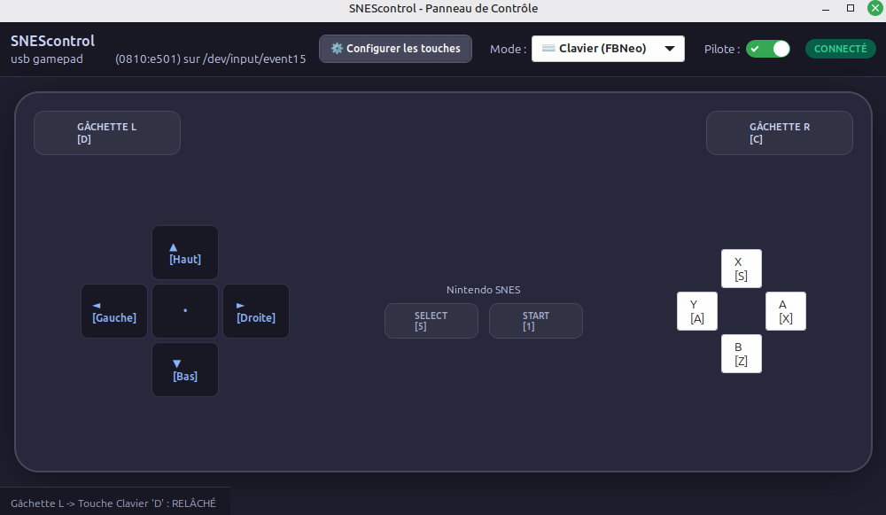

<div align="center">

# SNEScontrol


An interactive GTK3 graphical application and resident C driver adapter for USB SNES controllers (`0810:e501` "usb gamepad") on Linux.

SNEScontrol captures raw input, corrects d-pad axis behavior into clean digital events via `uinput` and `EVIOCGRAB`, and provides real-time visual button feedback. 



</div>

## Features

- **Interactive GTK3 Interface**
    
    - Complete SNES controller rendering featuring custom iconography.
        
    - Real-time green highlighting for every physical button and directional press.
        
    - On-the-fly toggle switch to enable or disable the virtual driver (`uinput` + `EVIOCGRAB`).
        
    - Automatic hotplug detection for connect and disconnect events.
        
- **D-Pad Axis Correction**
    
    - Instant conversion of analog `ABS_X` / `ABS_Y` (range `0..255`) into native digital `BTN_DPAD_*` and `ABS_HAT0*` events.
        
- **Full Button Mapping**
    
    - Complete mapping for A, B, X, Y, L, R, Select, and Start (including R trigger mapping on code 293 / `BTN_PINKIE`).
        
- **Native Debian (`.deb`) Integration**
    
    - Automatic `udev` rule (`/lib/udev/rules.d/70-snescontrol.rules`) allowing unprivileged execution without `sudo`.
        
    - Full desktop menu integration (GNOME, Cinnamon, XFCE) with custom icon support.
        

## Installation

### Pre-built Debian Package (Recommended)

Install the package directly using `apt` or `dpkg`:

```
sudo apt install ./snescontrol_1.1.0_amd64.deb
```

Or using `dpkg`:

```
sudo dpkg -i snescontrol_1.1.0_amd64.deb
```

Once installed, **SNEScontrol** will be available in your application menu (Games or Utilities section) or executable via terminal:

```
snescontrol
```

### Uninstallation

To remove the application and associated rules cleanly:

```
sudo apt remove snescontrol
```

## Building from Source

### Prerequisites

Ensure GTK3 development libraries and build tools are installed:

```
sudo apt update
sudo apt install build-essential libgtk-3-dev pkg-config
```

### Build & Package Commands

Compile the binary or build a new `.deb` package using the included `Makefile`:

```
# Build the local binary only
make

# Build the complete .deb package
make deb
```

## CLI Usage Modes

SNEScontrol supports several operational modes depending on your workflow:

|Command|Description|
|---|---|
|`snescontrol`|Launches the interactive GTK3 graphical interface (default mode).|
|`snescontrol --test`|Runs an interactive input test session directly in the console.|
|`snescontrol --cli`|Executes in standalone console mode without GUI overhead.|
|`snescontrol --daemon`|Runs silently as a background service daemon.|

## Credit
Built by Ar1st1d3 with Antigravity.

## License

This project is released under the [MIT License](./LICENSE.md).

